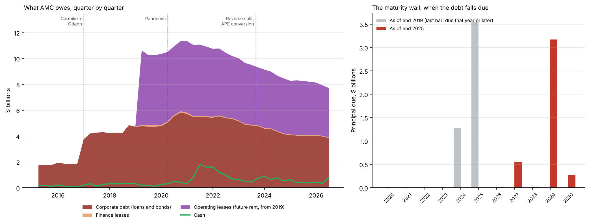
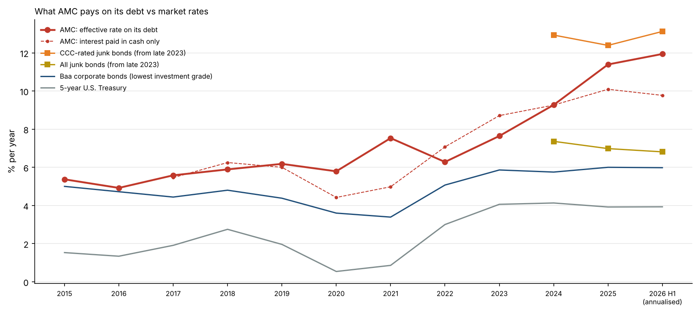
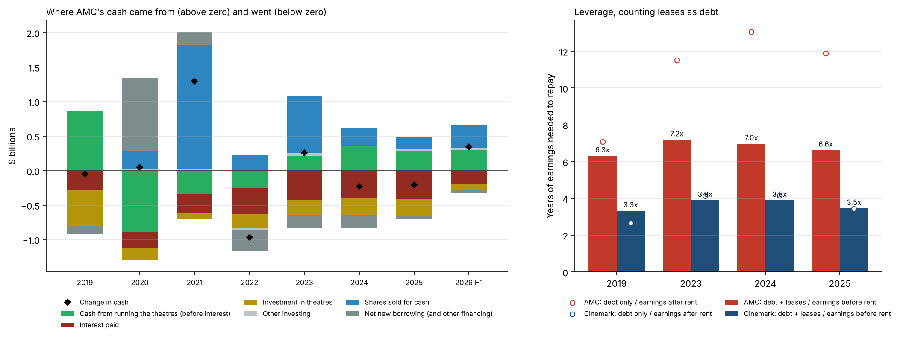
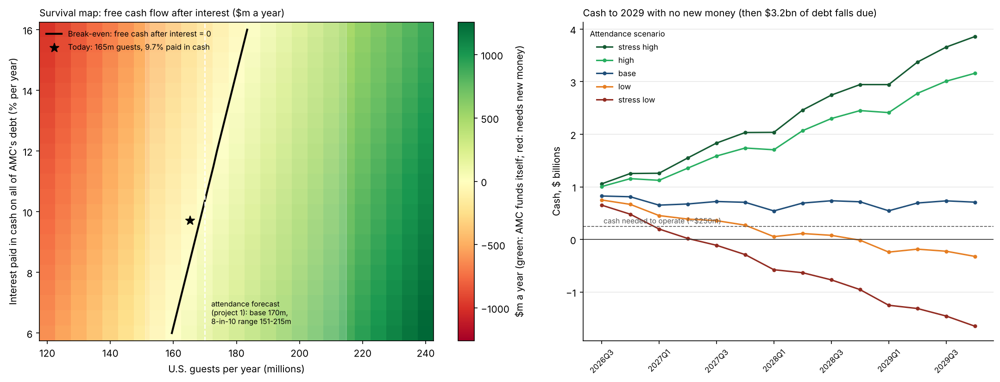

# AMC: Debt and Survival

**What does AMC owe, what has it cost, where did the money go, and under which attendance and interest-rate scenarios can it pay its way?**

The final project in a series on AMC and the movie business. **The conclusion of the whole series, and what it means, is in [CONCLUSION.md](CONCLUSION.md).**

1. [Movie profitability](https://github.com/julixlyz08/movie_profitability_analysis): which films earn the best return, and when they should be released.
2. [AMC attendance forecast and subscription model](https://github.com/julixlyz08/amc-attendance-forecast-subscription): how many people will go to AMC theatres.
3. [AMC stock vs attendance](https://github.com/julixlyz08/amc-stock-vs-attendance): the stock does not move with attendance; issuing new shares explains the price collapse.
4. [How AMC makes money](https://github.com/julixlyz08/amc-how-it-makes-money): the theatres roughly break even; interest turns that into large losses.
5. **This project**: the debt behind those losses, and a model that connects the series to ask whether AMC can carry it.

> Independent project using public SEC filings and market data. Not affiliated with or endorsed by AMC Entertainment or Cinemark. Not investment advice.

## Summary of findings

**Short answer: AMC sits right on the line.** At today's interest cost it needs about **168 million U.S. guests a year** to pay its way. It had **165 million** over the last four quarters, and the attendance project's central forecast for the next year is **170 million**. Since 2020, selling shares has paid the interest. In 2029, **$3.2 billion of debt falls due at once**, and that refinancing will depend on whether attendance has moved clearly above the line by then.

**Layer 1: the debt**

1. **The debt was built in two steps.** AMC owed $1.9bn at the end of 2015. The 2016-17 acquisitions (Carmike, Odeon/UCI, Nordic) took that to **$4.2bn**, and the pandemic to a peak of **$5.7bn** at the end of 2020. Since then it has come down to **$3.9bn** (June 2026), mostly through swaps for shares. On top of that sit **$3.8bn of future rent** (operating leases).
2. **Most of it falls due in a single year.** At the end of 2025, **$3.2bn of the $4.0bn (79%) was due in 2029.** In 2026 AMC pushed its 2027 Odeon notes out to 2031, which leaves 2029 as the wall.
3. **The interest rate has doubled.** AMC's effective rate on its debt was 5-6% a year from 2015 to 2019, and **11.4% in 2025 and 11.9% in the first half of 2026.** The gap over 5-year Treasuries widened from about 4 points to **8 points**. AMC now pays far more than the average junk-bond issuer (7.0% in 2025) and close to the riskiest, CCC-rated borrowers (12.4%). About 9.7 points are paid in cash; the rest is added to the debt (interest paid in kind) or comes from amortising discounts.

**Layer 2: follow the money**

4. **Shares paid the interest.** From 2020 to June 2026, AMC sold **$3.9bn of shares for cash**. Over the same period it paid **$2.3bn of interest** and invested $1.3bn in its theatres, while running the theatres used $0.3bn of cash (heavy losses in 2020-22, positive since 2023). Since 2023 the theatres generate cash before interest (+$287m in 2025), but not enough to cover interest ($407m) and investment ($246m) as well.
5. **Leases make it worse, not better.** AMC's debt is **11.9 times** a year's earnings (2025), against **3.5 times** for Cinemark. Counting leases as debt and rent as part of earnings (how credit analysts measure theatre chains), the gap is 6.6 times against 3.5.
6. **Debt became shares, at ever lower prices.** AMC issued about **$1.48bn of shares** to cancel debt or pay lenders' fees: **324 million shares** (split-adjusted), about **36% of the 893 million outstanding** in July 2026. The value per share issued fell from $137 in 2021 (split-adjusted) to **$1.60 in 2026**, so each dollar of debt cancelled cost more and more of the company.

**Layer 3: can AMC carry it?**

7. **Break-even depends far more on attendance than on interest rates.** Each extra U.S. guest leaves about $15 after variable costs, so each extra point of interest rate on $3.9bn of debt (about $39m a year) needs roughly **2.4 million more guests**. AMC funds itself at about **160 million guests if its debt cost 6%**, **168 million at today's 9.7% cash rate**, and **185 million at 16%**.
8. **The attendance forecast straddles the line** (see the cash paths chart):
   - **Base forecast (170m guests):** cash stays roughly flat at about $0.7bn to 2029.
   - **High forecast (215m):** AMC builds about $0.7bn of cash a year.
   - **Low forecast (151m):** cash falls below what a chain this size needs (about $250m) in early 2028, and runs out by the end of 2028.
   - **Stress low (127m):** cash runs out in 2027.
9. **Even in the base case, the 2029 wall needs new money.** Cash of about $0.7bn cannot repay $3.2bn. AMC will need lenders to refinance, and they will lend at a rate they can believe AMC can pay. On this model, every year of attendance clearly above the break-even line makes that easier, and every year below it means more share sales.






## Interactive dashboard

**[AMC: Can it carry its debt? (Tableau Public)](https://public.tableau.com/app/profile/julie.loyez/viz/AMCCanitcarryitsdebt/AMCdebtandsurvival)**

Three views in one story:
- **The debt:** what AMC owes since 2015, when it falls due, and what it costs against market rates.
- **Can AMC carry its debt?:** pick any U.S. attendance, interest rate, spend per guest and fixed-cost level, and see whether AMC funds itself or needs new money. Click a square on the map or use the sliders.
- **Cash to 2029:** AMC's cash under the five attendance scenarios, with no new shares or loans.

## Questions

| # | Question | Script |
|---|---|---|
| 1 | **What does AMC owe, at what rate, and when is it due?** | `01_debt_and_maturities.py` |
| 2 | **Where did the debt come from?** | `01_debt_and_maturities.py` |
| 3 | **How much does it really cost, compared with market rates?** | `02_cost_of_debt.py` |
| 4 | **Where did the cash come from and where did it go, 2020 to 2026?** | `03_cash_leases_swaps.py` |
| 5 | **Leverage including leases, against Cinemark** | `03_cash_leases_swaps.py` |
| 6 | **How much debt was swapped for shares, and at what price?** | `03_cash_leases_swaps.py` |
| 7 | **Under which attendance and interest-rate scenarios can AMC carry its debt?** | `04_survival_model.py` |
| 8 | **Explore any scenario yourself** | [Tableau Public dashboard](https://public.tableau.com/app/profile/julie.loyez/viz/AMCCanitcarryitsdebt/AMCdebtandsurvival) | 

## Data

| Source | What | Where |
|---|---|---|
| Earlier projects | U.S. attendance and attendance scenarios (project 1); quarterly income statements for AMC and Cinemark (project 3) | `data/amc_quarterly.csv`, `data/attendance_scenarios.csv`, `data/*_income_statement.csv` |
| Each 10-Q and 10-K's full XBRL file | Debt by instrument, stated and effective rates, balance sheets, cash flows, lease liabilities, debt-for-equity exchanges, maturity schedules | `data/amc_xbrl_full.csv.gz`, `data/cnk_xbrl_full.csv.gz` (`fetch_debt_data.py`) |
| U.S. Treasury and New York Fed (FRED did not respond to scripts) | 5- and 10-year Treasury yields, SOFR | `data/rates_monthly.csv` (`fetch_rates.py`) |
| FRED, downloaded by hand | Moody's Baa corporate yield (from 2014); ICE BofA high-yield and CCC yields (FRED only shows these from October 2023) | `data/BAA.csv`, `data/BAMLH0A0HYM2EY.csv`, `data/BAMLH0A3HYCEY.csv` |
| Built from the above | Balance sheets, maturities, instrument ledger, cash flows, debt-for-equity, monthly market rates | `data/*.csv` (`build_debt_data.py`) |

Data notes:
- **Checks.** The cash-flow split adds back exactly to the reported change in cash every year (`check_m` column). The instruments tagged in the filings add up to 91% of reported debt at the end of 2019, and to 100% (within 2%) at the end of 2025 and June 2026. The tagged amounts mix carrying amounts and face amounts, so the ledger is a picture of the debt stack, not an exact reconciliation.
- **Debt for shares** is measured on the share side (shares issued and their value). AMC's "debt converted" tags also include exchanges of old debt for new debt (such as second-lien notes swapped into new term loans), which are not debt-for-equity. The 2023 conversion of APE units into common shares is not counted, because it was not a debt transaction.
- **Equity raised** comes from the cash-flow statement. For 2020 it comes from the equity statement, because the cash-flow line is only tagged by share class. The 2021 total includes the $230m Mudrick placement, which AMC reports on a separate line.
- **Operating leases** are only on the balance sheet from 2019 (a new lease accounting standard).
- **Effective interest rate** = interest on corporate borrowings (including interest paid in kind and amortised discounts) divided by the average of five quarter-end debt balances. The cash version uses interest paid from the cash-flow statement.
- **Market rates** are yearly averages of monthly values. High-yield yields are shown only for years with at least six months of data.

## Method: the survival model

All assumptions are listed at the top of `04_survival_model.py` and saved to `results/04_model_inputs.csv`.

- **Revenue** = U.S. guests × AMC's total revenue per U.S. guest ($31.65 over the last four quarters). International theatres are assumed to move with the U.S.
- **Cash operating costs** = $1.9bn a year fixed plus 52.5% of revenue: a straight-line fit of the last 16 quarters, as in project 3. Plus $32m a year of cash costs not in the income statement (deferred rent repayments, working capital), calibrated on 2024 to mid-2026 cash flows.
- **Theatre investment:** $225m a year. **Spend per guest** grows 2% a year; **fixed costs** grow 3% a year.
- **Interest:** today's cost (12.0% effective, of which 81% paid in cash) for the cash paths; for the map, a single cash rate on all the debt, as on refinanced debt.
- **Check:** on the last four quarters, the model gives free cash after cash interest of -$44m a year, close to what the cash-flow statement shows.
- **Cash paths:** the five attendance scenarios of project 1 for 2026 Q3 to 2027 Q2. Later quarters repeat the forecast year. The 2027 notes ($126m) are repaid in cash. No new shares or loans.

## Limitations

- **The model is deliberately simple.** It has no taxes, no seasonality of costs within the year, no change in theatre count, and international attendance follows the U.S. The break-even fit holds within the range seen since 2022.
- **A refinancing depends on lenders, not just cash flow.** The model shows when AMC can pay interest from its own earnings, not whether lenders will roll over $3.2bn in 2029 or at what price.
- **The ledger relies on how AMC tagged its filings,** which changed over time. Some instruments have only an effective rate tagged, others only a stated coupon, and a few have neither.
- **High-yield benchmarks start in October 2023.** For earlier years, the Baa corporate yield is a floor, since it is an investment-grade rate.
- **Not investment advice.** The project describes AMC's position from public data; it does not predict the share price.

## How to run

```
pip install pandas numpy matplotlib requests
python fetch_debt_data.py        # set your name and email in SEC_USER_AGENT first; about 5 to 10 minutes
python fetch_rates.py            # Treasury, SOFR; FRED is tried first
# download BAA, BAMLH0A0HYM2EY, BAMLH0A3HYCEY from fred.stlouisfed.org into data/ (CSV)
python build_debt_data.py
python 01_debt_and_maturities.py
python 02_cost_of_debt.py
python 03_cash_leases_swaps.py
python 04_survival_model.py
```

## Repository layout

```
fetch_debt_data.py, fetch_rates.py   download the SEC and market data
build_debt_data.py                   balance sheets, maturities, ledger, cash flows, debt-for-equity, rates
common.py                            shared loaders and chart helpers
01_ ... 04_*.py                      one script per group of questions
CONCLUSION.md                        what the whole series adds up to, and why it matters
data/, charts/, results/
```
